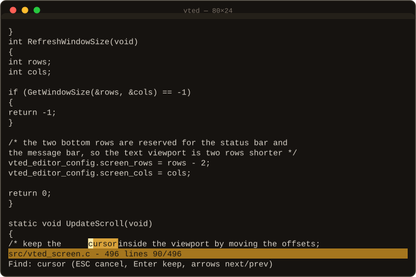

# vted — vex terminal text editor

A small, fast terminal text editor for Linux: one C11 binary, no
dependencies beyond the C standard library and POSIX. No curses, no
autotools, no cmake — just `make`.

[](https://github.com/E-Vex/vted/actions/workflows/build.yml)
[](https://github.com/E-Vex/vted/releases)
[](https://en.wikipedia.org/wiki/C11_(C_standard_revision))
[](LICENSE)

<p align="center">

</p>

## Install

### From git (the usual way)

```sh
git clone https://github.com/E-Vex/vted.git
cd vted
make
sudo make install
```

This installs:

- `/usr/local/bin/vted` — the editor
- `/usr/local/share/man/man1/vted.1` — the manual (`man vted`)

To try it before installing anything, just run `./vted` after `make`.

### From a release tarball

```sh
curl -LO https://github.com/E-Vex/vted/archive/refs/tags/v0.1.0.tar.gz
tar xzf v0.1.0.tar.gz
cd vted-0.1.0
make && sudo make install
```

See the [releases page](https://github.com/E-Vex/vted/releases) for all
versions.

### Without sudo

Install into your home directory instead:

```sh
make PREFIX="$HOME/.local" install
```

Make sure `~/.local/bin` is on your `PATH`. The install locations are
fully controlled by `PREFIX` and `DESTDIR` (useful for package
builders).

### Uninstall

```sh
sudo make uninstall
```

### Requirements

- Linux
- a C11 compiler (`gcc` or `clang`)
- `make`

That is the whole list.

## Usage

```
vted            # start with an empty buffer
vted file.c     # open a file
man vted        # the full manual
```

## Keys

| Key            | Action                                         |
| -------------- | ---------------------------------------------- |
| arrows         | move the cursor (wraps across lines)          |
| Home / End     | jump to start / end of line                   |
| PageUp/Down    | move one viewport up / down                    |
| Enter          | split the line at the cursor                  |
| Backspace      | delete left, merge lines at column zero       |
| Delete         | delete under the cursor                        |
| typing         | insert at the cursor                           |
| Ctrl-S         | save the buffer to its file                    |
| Ctrl-F         | incremental search (arrows jump, ESC restores) |
| Ctrl-Q         | quit (three extra presses when modified)      |

## Features

- Raw terminal mode with automatic settings restore on exit
- Alternate screen buffer: your shell history stays untouched
- Open files from the command line, edit, and save them back
- Full cursor movement: arrows, Home, End, PageUp, PageDown
- Vertical and horizontal scrolling for files of any size
- Insert and delete text, split lines with Enter, merge with Backspace
- UTF-8 aware: multibyte characters can be typed and displayed
- Status bar with filename, line count, modified marker and cursor position
- Message bar for status and warnings
- Incremental search (Ctrl-F) with match highlighting
- Quit protection: unsaved changes require repeated Ctrl-Q

## Documentation

- [docs/architecture.md](docs/architecture.md) — module lifecycle and the edit loop
- [docs/rendering.md](docs/rendering.md) — how a frame reaches the terminal
- [docs/terminal-modes.md](docs/terminal-modes.md) — raw mode and the alternate screen
- [docs/vted.1](docs/vted.1) — the manual page source

| Module            | Responsibility                              |
| ----------------- | ------------------------------------------- |
| `vted_terminal`   | raw mode, terminal save/restore, fatal exit |
| `vted_keyboard`   | raw byte reading, escape sequence parsing   |
| `vted_screen`     | viewport, scrolling, rendering, bars        |
| `vted_row`        | the text buffer and row editing primitives  |
| `vted_file`       | loading and saving files                    |
| `vted`            | the editor core: key dispatch and editing   |

## Roadmap

vted is under active development. Planned next:

- Tab key handling with tab stops
- UTF-8 aware deletion (never split a multibyte sequence)
- Go-to-line and save-as prompts
- Syntax highlighting
- Undo/redo

## Contributing

The project is built one small step at a time — every commit does one
thing. If you pitch in, keep it that way: a change should build clean
(`make CFLAGS="-Wall -Wextra -Wconversion -Werror"` is enforced by CI)
and be one focused commit.

## License

MIT — see [LICENSE](LICENSE).
