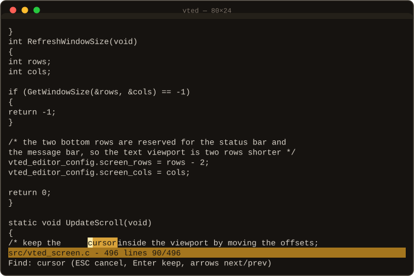

# vted — vex terminal text editor

A small, fast terminal text editor for Linux: one C11 binary, no
dependencies beyond the C standard library and POSIX. No curses, no
autotools, no cmake — just `make`.

[](https://github.com/E-Vex/vted/actions/workflows/build.yml)
[](https://github.com/E-Vex/vted/releases)
[](https://en.wikipedia.org/wiki/C11_(C_standard_revision))
[](LICENSE)

<p align="center">

</p>

## Install

Ready-made packages are attached to every
[release](https://github.com/E-Vex/vted/releases). They install
`vted` and the manual page. Each release also carries a
`SHA256SUMS.txt` so the downloads can be checked with `sha256sum -c`:

| File                              | Installs on                          | How                                        |
| --------------------------------- | ------------------------------------ | ------------------------------------------ |
| `vted_<v>_<arch>.deb`             | Debian, Ubuntu, Mint, Pop!_OS, ...   | `sudo apt install ./vted_<v>_<arch>.deb`   |
| `vted-<v>-1.<arch>.rpm`           | Fedora, RHEL, openSUSE, ...          | `sudo dnf install ./vted-<v>-1.<arch>.rpm` |
| `vted-<v>-<arch>.AppImage`        | any x86_64 distro                    | `chmod +x` and run                         |
| `vted-<v>-linux-<arch>.tar.gz`    | any x86_64 distro                    | unpack, then `sudo ./install.sh`           |

The examples below use version 0.2.0; grab the file names from the
latest release page.

### Debian, Ubuntu, Mint and friends (.deb)

```sh
sudo apt install ./vted_0.2.0_amd64.deb
```

The package carries a statically linked binary, so `apt` has nothing
to resolve and no repositories need to be added — it installs straight
into `/usr/bin` with the manual page in place. `dpkg -i` works just
the same. Remove it again with `sudo apt remove vted`.

### Fedora, RHEL, CentOS, openSUSE (.rpm)

```sh
sudo dnf install ./vted-0.2.0-1.x86_64.rpm     # Fedora, RHEL, CentOS
sudo zypper install ./vted-0.2.0-1.x86_64.rpm  # openSUSE
```

The RPM is built from source against the system C library, the way RPM
distributions expect, so its dependencies are checked honestly at
install time. Remove it with `sudo dnf remove vted` or
`sudo zypper remove vted`.

### Any distro — AppImage

```sh
chmod +x vted-0.2.0-x86_64.AppImage
./vted-0.2.0-x86_64.AppImage
```

Nothing is installed and nothing is extracted — it just runs. To use
it as plain `vted`, put it on your `PATH`:

```sh
install -m 755 vted-0.2.0-x86_64.AppImage ~/.local/bin/vted
```

### Any distro — static binary tarball

For everything without `.deb` or `.rpm` support — Arch, Alpine,
Gentoo, Void, a chroot, a rescue disk:

```sh
tar xzf vted-0.2.0-linux-x86_64.tar.gz
cd vted-0.2.0-linux-x86_64
sudo ./install.sh                          # or: PREFIX="$HOME/.local" ./install.sh
```

The binary inside is statically linked (musl), so it runs on glibc and
musl systems alike with zero dependencies. Uninstall with
`sudo rm /usr/local/bin/vted /usr/local/share/man/man1/vted.1`.

### From git (the usual way)

```sh
git clone https://github.com/E-Vex/vted.git
cd vted
make
sudo make install
```

This installs:

- `/usr/local/bin/vted` — the editor
- `/usr/local/share/man/man1/vted.1` — the manual (`man vted`)

To try it before installing anything, just run `./vted` after `make`.

### From a release source tarball

```sh
curl -LO https://github.com/E-Vex/vted/archive/refs/tags/v0.1.0.tar.gz
tar xzf v0.1.0.tar.gz
cd vted-0.1.0
make && sudo make install
```

See the [releases page](https://github.com/E-Vex/vted/releases) for all
versions.

### Without sudo

Install into your home directory instead:

```sh
make PREFIX="$HOME/.local" install
```

Make sure `~/.local/bin` is on your `PATH`. The install locations are
fully controlled by `PREFIX` and `DESTDIR` (useful for package
builders).

### Uninstall

```sh
sudo make uninstall
```

### Requirements

- Linux
- a C11 compiler (`gcc` or `clang`)
- `make`

That is the whole list.

## Usage

```
vted                    # start with an empty buffer
vted file.c             # open a file
vted a.c b.c c.c        # open several files, one buffer each
vted +42 file.c         # open it with the cursor on line 42
grep TODO *.c | vted -  # edit what another command prints
vted --help             # the command line in short
vted --version          # the version
man vted                # the full manual
```

Text piped in on standard input becomes an unnamed buffer: Ctrl-S
then asks where to save it. It can sit beside named files
(`vted - notes.txt`), each in a buffer of its own.

## Settings

Settings live in `$XDG_CONFIG_HOME/vted/vtedrc`
(`~/.config/vted/vtedrc` by default) and are read at startup:

```
set tab-width 4
set insert-spaces on
set line-numbers off
set show-tabs on
set wrap on
set wrap-indent off
set wrap-column 80
set indent-guides on
```

Blank lines and `#` comments are skipped, a later line wins over an
earlier one, and a line that cannot be used is reported in the
message bar. The keys are the same things Ctrl-W, Ctrl-T, Ctrl-N,
Alt-t, Ctrl-L, Alt-i and Alt-g set while editing.

## Keys

| Key             | Action                                           |
| --------------- | ------------------------------------------------ |
| arrows          | move the cursor (wraps across lines); a vertical
  aim that falls inside a row's indent lands past it, on
  the first non-blank                         |
| Ctrl-Left/Right | move by word (Alt-arrows and Alt-b/f work too)   |
| Home / End      | start / end of the line, or of the wrapped
  screen line it sits on                             |
| PageUp/Down     | move one viewport up / down, of screen
  lines when wrapping is on                       |
| Alt-h / Alt-m / Alt-l | jump to the top, middle or bottom screen
  line of the viewport (H, M and L in vi)         |
| Alt-e / Alt-y   | scroll the viewport one screen line down / up,
  the way Ctrl-E and Ctrl-Y do in vi (those close
  the buffer and redo here)                       |
| Alt-t           | show or hide the tab characters: a shown tab
  carries a » and a trail of ·, in the gray of a comment |
| Alt-i           | keep the indent on the wrapped lines: a row
  that flows over several screen lines continues under
  its own first line's text                     |
| Alt-g           | dot the tab stops the indents cross: every
  blank of a row's leading whitespace that sits on a
  stop carries a ·, in a quiet slate blue         |
| Enter           | split the line at the cursor, keeping its indent |
| Tab             | insert a tab, shown up to the next tab stop      |
| Backspace       | delete the character on the left, merge lines    |
| Delete          | delete the character under the cursor            |
| Ctrl-K          | delete the whole line under the cursor           |
| Ctrl-D          | duplicate the line under the cursor              |
| Ctrl-Up/Down    | move the current line up or down                 |
| Shift-Arrows    | start or extend a character selection            |
| Ctrl-C / Ctrl-X | copy or cut the selection (or the current line)  |
| Ctrl-R          | search and replace every occurrence              |
| Ctrl-Z          | undo (a typing burst is one change)              |
| Ctrl-Y          | redo the last undone change                      |
| typing          | insert at the cursor (replaces the selection)    |
| Ctrl-S          | save the buffer (asks for a name when unnamed)   |
| Ctrl-O          | open another file as a buffer of its own         |
| Ctrl-E          | close the buffer being edited                    |
| Ctrl-B          | pick a buffer from a list of what is open        |
| Alt-, / Alt-.   | step through the open buffers (wraps around)     |
| Alt-1 .. Alt-9  | jump to the buffer with that number               |
| Ctrl-G          | go to a line number (ESC cancels)                |
| Ctrl-F          | incremental search: every match lights up while
  you type and the prompt counts them, arrows step between matches,
  a match that left the viewport lands mid-viewport, ESC restores |
| Ctrl-N          | show or hide the line numbers                    |
| Ctrl-L          | wrap long lines over several screen lines,
  breaking at word boundaries                       |
| Ctrl-T          | toggle Tab between spaces and a tab character    |
| Ctrl-W          | set the tab width in cells (per buffer)          |
| Ctrl-Q          | quit (three extra presses when modified)         |

With several buffers open, Ctrl-B lists them with their numbers and
names (a `+` marks unsaved changes): the arrows wrap around the list,
Enter takes the one under the selection, Ctrl-E closes it without
leaving the list (unsaved changes ask for three more presses first)
and ESC stays where you were.
Alt-, and Alt-. step through them and Alt-1 to Alt-9 jump to one by
number, while the status bar shows which one is being edited
("2/3, Ln 5/120, Col 12"). Ctrl-E closes the buffer being edited:
unsaved changes ask for three more presses first, the way Ctrl-Q
does, and closing the last buffer starts a fresh empty one.

## Features

- Several files in one session: every file named on the command line
  opens in a buffer of its own, Ctrl-O opens another from within the
  editor, and Alt-, / Alt-. or Alt-1 to Alt-9 move between them; Ctrl-B
  picks one from a list over the bottom of the viewport. A
  buffer keeps its cursor, viewport and undo history while it waits,
  the status bar says which one is on, and opening a path that is
  already open switches to that buffer instead of opening it twice;
  Ctrl-E closes the buffer being edited — unsaved changes hold the
  close back the way they hold a quit back — and closing the last
  buffer starts a fresh empty one; unsaved changes in any buffer hold
  a quit back
- Raw terminal mode with automatic settings restore on exit
- Alternate screen buffer: your shell history stays untouched
- Open files from the command line, edit, and save them back
- Full cursor movement: arrows, Home, End, PageUp, PageDown
- Word movement with Ctrl or Alt and the arrows, or Alt-b and Alt-f; a word
  is a run of letters, digits and underscores, or a run of punctuation
- Vertical and horizontal scrolling for files of any size; long lines
  wrap over several screen lines instead with Ctrl-L, breaking at word
  boundaries so a word never straddles two lines — one longer than a
  line breaks by character — the up and down arrows then stepping over
  the wrapped lines and PageUp/PageDown paging a viewport of them, and
  a line taller than the viewport scrolling inside itself; Home and End
  start and end the screen line the cursor sits on
- Viewport-relative jumps with Alt-h, Alt-m and Alt-l: the cursor lands
  on the start of the top, the middle or the bottom screen line of the
  viewport, the way H, M and L work in vi; a wrapped layout is walked
  line by line, so a viewport that starts inside a tall row counts from
  the line it starts on, and a jump past the end of the text lands on
  its last line
- Viewport scrolling with Alt-e and Alt-y, the letters vi spells
  Ctrl-E and Ctrl-Y (which close a buffer and redo here): the viewport
  moves one screen line at a time over the wrapped layout while the
  cursor keeps its place in the text, coming along only when the scroll
  would leave it off screen, and stopping at the first line of the text
  and where the last line, with the phantom row past the end, reaches
  the bottom of the viewport
- Insert and delete text, split lines with Enter, merge with Backspace
- Delete the whole line with Ctrl-K, duplicate it with Ctrl-D, move it up
  or down with Ctrl-Up/Down
- Select text with Shift-Arrows; copy or cut the selection (or the current
  line) to the system clipboard with Ctrl-C / Ctrl-X via OSC 52
- Search and replace every occurrence with Ctrl-R; each replacement is one
  undo step
- Undo and redo with Ctrl-Z and Ctrl-Y; the cursor follows along, and a
  run of typing or backspace keystrokes in one place undoes as one step
- Line endings are preserved: LF, CRLF, CR and mixed files save back
  byte for byte, files without a trailing newline keep having none, and
  new lines take the ending of the line they came from
- Auto-indent: Enter starts the new line with the indent of the current one
- UTF-8 aware: the cursor and deletion move by whole characters, wide
  (CJK, emoji) and combining characters take the right number of cells
- Tabs expand to configurable tab stops (8 cells by default; Ctrl-W sets
  the width, and each buffer keeps its own; Ctrl-T toggles Tab between
  spaces up to the next stop and a
  real tab character); Alt-t shows the tabs where they sit, a » and a
  trail of · in the gray of a comment taking the same cells either way;
  control characters show as `^X` and invalid bytes
  as `�`, so nothing odd ever reaches your terminal
- Indent guides with Alt-g (`set indent-guides on`): every tab stop a
  row's leading whitespace crosses carries a quiet ·, so the levels of
  the nesting line up as dotted rails down the screen; the stops follow
  the tab width (Ctrl-W), the cells they sit in take the same room
  either way, and a tab shown by Alt-t keeps its own » on the stop it
  starts
- The cursor keeps its display column across short lines when moving
  up and down, and an aim that falls inside a row's indent lands past
  it, on the first non-blank glyph, so the cursor never rests between
  the blanks — a scroll that drags the cursor along keeps the spot it
  lands on
- Line numbers in a gutter, the current one in bold; Ctrl-N hides them and
  a terminal too narrow for them drops them on its own
- The bracket the cursor sits on (or the one right behind it) has its
  partner highlighted, across as many lines as nesting takes; a match
  farther than a megabyte away counts as missing
- Syntax highlighting picked from the file name: C, C++, Python, shell
  scripts, Makefiles, JavaScript, TypeScript, Rust, Go, JSON,
  Markdown, HTML, XML, CSS, Lua, Ruby, YAML, TOML, INI, SQL,
  Dockerfiles, C#, Java, PHP, dotenv files and diffs; the name a
  function is defined by colors at its definition sites in the C-like
  languages; truecolor when COLORTERM says so, with 256-color and
  16-color fallbacks
- Status bar with filename, line count, modified marker and the cursor's line
  and display column
- A column marker at a set width (`set wrap-column 80`): a quiet gray
  background over that text cell of every row on screen, carried by
  the glyph that crosses it and padded into the blank cells past the
  text, so it is plain where a line should end
- Message bar for status and warnings
- Incremental search (Ctrl-F): every match of the query lights up
  while it is being typed — amber behind the text, the one under the
  cursor inverted — and the prompt counts where that match stands
  among them all ("3 of 17", "no matches"); arrows step through
  them, a match that left the viewport lands it mid-viewport, the
  wrapped rows around it counted at their real heights
- Go to a line with Ctrl-G; a number past the end lands on the last
  line, and the line lands mid-viewport, the tall rows of wrapping
  counted at their real heights
- Saving an unnamed buffer asks for a file name; the buffer stays unnamed
  if the file cannot be written
- Saves are atomic: the text goes to a temporary file that is renamed
  over the target, so a failed save never destroys the original, and the
  file's permissions are kept
- Quit protection: unsaved changes require repeated Ctrl-Q

## Documentation

- [docs/architecture.md](docs/architecture.md) — module lifecycle and the edit loop
- [docs/rendering.md](docs/rendering.md) — how a frame reaches the terminal
- [docs/terminal-modes.md](docs/terminal-modes.md) — raw mode and the alternate screen
- [docs/vted.1](docs/vted.1) — the manual page source

| Module            | Responsibility                              |
| ----------------- | ------------------------------------------- |
| `vted_terminal`   | raw mode, terminal save/restore, fatal exit |
| `vted_keyboard`   | raw byte reading, escape sequence parsing   |
| `vted_screen`     | viewport, scrolling, rendering, bars        |
| `vted_row`        | text buffer, row editing and cell layout    |
| `vted_undo`       | the undo and redo history                   |
| `vted_utf8`       | UTF-8 decoding, boundaries and cell widths  |
| `vted_file`       | loading and saving files                    |
| `vted_syntax`     | coloring text by the language of the file   |
| `vted_config`     | the settings file                           |
| `vted_buffers`    | the open files and switching between them  |
| `vted_cli`        | the command line: options, usage, version   |
| `vted`            | the editor core: key dispatch and editing   |

## Contributing

The project is built one small step at a time — every commit does one
thing. If you pitch in, keep it that way: a change should build clean
(`make CFLAGS="-Wall -Wextra -Wconversion -Werror"` is enforced by CI)
and be one focused commit.

## License

MIT — see [LICENSE](LICENSE).
